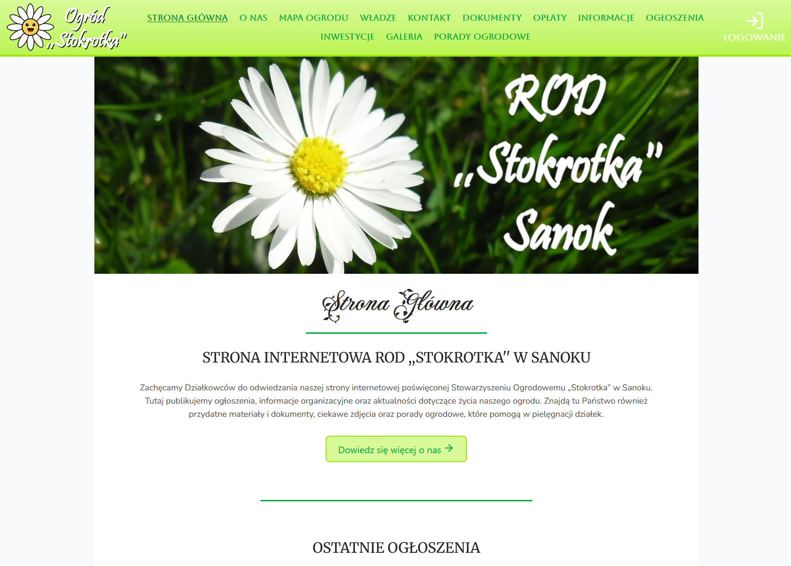

# 🌿 Strona internetowa ROD „Stokrotka” w Sanoku

Projekt strony internetowej dla **Rodzinnego Ogrodu Działkowego „Stokrotka” w Sanoku**, wykonany jako inicjatywa społeczna i projekt hobbystyczny.  
Strona pełni funkcję **informacyjną, ogłoszeniową i blogową**, a w przyszłości zostanie rozbudowana o **panel zarządu**.

---

## 🔗 Podgląd projektu
👉 [Zobacz stronę na żywo](https://rod-stokrotka-sanok.vercel.app/)

---

## ⚙️ Technologie
- [Next.js](https://nextjs.org/) 
- [Tailwind CSS](https://tailwindcss.com/) 

> Backend w [Nest.js](https://nestjs.com/) 

---

## 📜 Autor
Projekt wykonany przez **Rafał Haduch** – pasjonat programowania i działkowiec z ROD „Stokrotka”.
